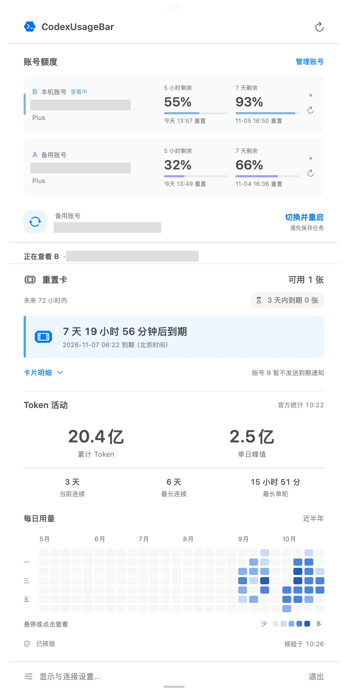
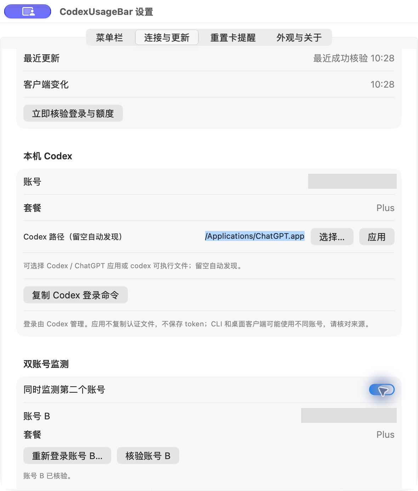

<div align="center">
  
  <h1>CodexUsageBar</h1>
  <p>A native macOS menu bar app for Codex quota, reset times, and token activity.</p>
  <p><a href="README.md">简体中文</a> · <strong>English</strong></p>
  <p><a href="https://github.com/1078302479/codex-usage-bar/releases/latest">Download</a> · <a href="#build-from-source">Build from source</a> · <a href="docs/architecture.md">Architecture</a></p>
</div>

v0.1.6 includes two-account monitoring and one-click switching to the alternate account with a client restart. See [account switching](docs/account-switch.md).

## Overview

CodexUsageBar is a lightweight macOS menu bar utility built with Swift, AppKit, and SwiftUI. It reads quota and official account token activity through your local Codex App Server. No API key entry, browser backend, or Python service is required by the native app.

This is an independent community project, not an official OpenAI application or an OpenAI-affiliated product.

## Features

- Monitor two accounts concurrently; selecting a row updates the menu bar, reset credits and Token activity.
- One-click alternate-account switching with a client restart, preserving the workspace and conversation list. The active account is listed first; disabling secondary monitoring hides switching.
- Online update checks at startup and every eight hours, with a new-release entry in the popup and manual checks in settings. Click to open the GitHub release download page.

- Remaining allowance and reset times for independent short-term and weekly windows; actual durations come from the service.
- Independent remaining-percentage color ranges for short- and long-term menu-bar quotas, including stacked mode. Default text colors remain unchanged.
- Circular quota gauges, a compact account/subscription header and refreshed light/dark activity views.
- Configurable menu bar metrics, provider icon, labels, plan name, and separators.
- Stacked mode: weekly allowance above the 5-hour allowance, or a regular single-line layout.
- Compact resets: `HH:mm` for the short window and `MM-dd` for the long window, with independently optional descriptions.
- Official lifetime tokens, peak daily tokens, longest-running turn, and current/longest activity streaks.
- A 26-week heatmap with immediate hover/click details and exact daily token counts.
- Event-following refresh with quota-only fallback checks every 15 seconds while the panel is visible and every 60 seconds in the background. Explicit 1-, 5-, and 15-minute polling remains available.
- Official reset-credit count, nearest expiry, count expiring within 72 hours, and per-card expiry details without guessing missing dates.
- Opt-in local expiry reminders 24 hours ahead, with fresh-validation catch-up, persistent account/card deduplication, and cancellation when usage, expiry, or account changes are detected.
- Automatic recovery from network request failures, timeouts, and child-process disconnections with 5/15/30/60/120/300-second backoff, capped at five minutes. A network-return hint expedites one coalesced query. Authentication, configuration, and compatibility errors require user action instead of repeated automatic retries.
- Explicit validation, stale-data, network-failure, login, and compatibility states, with the last successful validation and next retry time. Unverified cached data is labeled separately.
- Light, dark, and system appearance; an expanding/resizable popover; macOS login-item support.

Background resources: settings windows are released on close, and the quota panel releases its view while hidden. Quota monitoring and validation continue. Reopening restores current data and the panel height for the current run. Unchanged menu artwork is reused. Startup log discovery retains only the newest 24 candidates while still enumerating the directory.

## Screenshots

Actual **v0.1.6** screenshots captured on the maintainer’s Mac on **2026-10-30**. Account details are redacted and some images are cropped. Values reflect the capture time; the application UI is Chinese.

### Single and dual accounts

Single-account gauges and compact dual-account quota/reset rows. Selecting a row updates menu bar quota and details; the execution account is listed first.

<table>
  <tr><th>Single-account panel</th><th>Dual-account overview</th></tr>
  <tr>
    <td valign="top"></td>
    <td valign="top"></td>
  </tr>
</table>

### One-click execution account switching

Switch to the alternate account with a client restart while retaining the workspace and conversation list. Finish tasks and save work first. Viewing quotas does not switch execution identity.


### Token activity and reset credits

Official totals, peak daily usage, streaks, longest turn and a 26-week activity heatmap. Hover or click a date for details. The dual-account screenshot also shows reset-credit availability and expiry.


### Menu bar customization and online updates

Customize stacked rows, quotas, reset times, labels, separators and percentage colors. Check stable GitHub updates automatically every eight hours or manually.

<table>
  <tr><th>Menu bar settings</th><th>Updates and quota validation</th></tr>
  <tr>
    <td valign="top"></td>
    <td valign="top"></td>
  </tr>
</table>

### Account management and appearance

Authorize a second account through the official login page; stopping monitoring retains its login. Light, dark and system appearance are supported. The appearance screenshot is a cropped settings view.

<table>
  <tr><th>Connection and accounts</th><th>Appearance and version</th></tr>
  <tr>
    <td valign="top"></td>
    <td valign="top"></td>
  </tr>
</table>

## Requirements

| Item | Requirement |
| --- | --- |
| OS | macOS 14 or later |
| First release binary | Apple Silicon / arm64 |
| Codex | Installed and signed in with a ChatGPT account; required App Server methods must be supported |
| Network | Access to official Codex services |

No Intel binary is provided and Intel hardware has not been validated. API-key-only authentication does not provide the ChatGPT quota/account activity used by this app.

## Install

1. Download `CodexUsageBar-0.1.6-mac-arm64.dmg` from [Releases](https://github.com/1078302479/codex-usage-bar/releases/latest).
2. Open the DMG and drag **CodexUsageBar** into **Applications**.
3. Eject the installation disk and launch the app from Applications.
4. Optionally enable **Settings → Appearance & About → Launch at login**. The current UI is in Chinese.

Quit older copies before updating, launch CodexUsageBar after installation. The bundle identity is retained to preserve existing preferences.

**Signing:** the first release is ad-hoc signed and is not Apple Developer ID signed or notarized. macOS may show a security prompt. Check the release source and SHA256 checksums; build from source if you prefer not to run an unnotarized binary. Login items can require approval in System Settings and should be registered after moving the app to a stable location.

## Getting started

The app discovers Codex automatically. If discovery fails, select the executable in the connection settings. Sign in through Codex itself and check the masked account shown in the panel: the CLI and desktop client may use different accounts.

The app does not directly read authentication files, persist tokens, or start model inference. Codex owns authentication and network requests. Display preferences and a masked quota cache are stored locally; cached quota is revalidated after every launch. Account token activity is kept in memory only.

## Data and refresh behavior

### Online software updates

Open **Settings → Connection & Refresh → Software Update** to see the installed version and last check, or check manually. The app checks at startup and every eight hours, catching up after wake. Only stable public releases are considered; drafts and prereleases are excluded.

When a newer version is available, the popup shows a download entry that opens this project's GitHub release page. Download the DMG and replace the app in Applications. Nothing is downloaded, installed or restarted automatically. Failed checks can be retried manually and resume on the next interval. Only public release metadata is requested; no GitHub token or Codex account information is sent.

Online update checking is included in the refreshed v0.1.6 installer (build 11). If you downloaded v0.1.6 earlier, download it again and replace the installed app.

### Two-account monitoring (v0.1.6)

Enable **Settings → Connection & Refresh → Two-account monitoring**, choose **Sign in to a second account**, and select another ChatGPT account on the official login page. Account A follows the local Codex login; account B has an independent session. Both are checked concurrently, with compact quota/reset comparison rows. Select either card to view its reset credits, Token activity, and connection status below. A single menu bar item follows the account selected in the panel; selecting A or B switches both details and menu bar quota. The panel's top refresh button validates both accounts.

B uses `~/Library/Application Support/CodexUsageBar/accounts/secondary` as its isolated `CODEX_HOME`, with credentials managed by Codex in a user-private directory. The app never reads or copies A's authentication files. Disabling B stops monitoring but retains its login for later use. Reset-credit notifications currently remain exclusive to A. Signing into the same account twice does not combine or increase allowance.

Included in v0.1.6. Known desktop backend launch patterns identify the active account; unknown or conflicting instances disable switching. Switching gracefully quits and reopens ChatGPT: finish tasks and save work first. The original desktop workspace remains in use, with shared session/task state. No tokens are copied and no model proxy is used. Internal desktop overrides may change with client updates; verify the native Codex identity after restarting.

### Refresh rules

- Remaining allowance is `100 − usedPercent`, with independent windows.
- The default mode observes local quota events and validates changes against the service. Startup, opening the panel, waking, and reset boundaries also trigger checks.
- **Instant synchronization with the Codex client or other devices is not guaranteed.** Remote changes may appear at the next validation.
- Stale values have `*`; unknown, unverified, and reset-pending values show `--`. A timer never fabricates a refill to 100%.
- Activity comes from official `account/usage/read` and may lag. Missing data is not zero; local logs are not used to invent account-wide totals.
- Longest-running turn means the service's turn duration, not total conversation wall-clock time.
- Times use **Asia/Shanghai**. Heatmap dates preserve the service's date buckets.

See [architecture notes](docs/architecture.md) and the [official App Server documentation](https://learn.chatgpt.com/docs/app-server).

## Build from source

Use macOS with a Swift 6-capable Xcode/Command Line Tools installation. Python 3 is used for tests and packaging, not by the native runtime.

```sh
git clone https://github.com/1078302479/codex-usage-bar.git
cd codex-usage-bar
bash scripts/build-native.sh
```

Output: `build/CodexUsageBar.app`.

Checks:

```sh
bash scripts/test-native.sh
python3 -m unittest discover -s tests -v
node --check prototype/app.js
```

The native suite includes 39 core checks, 9 heatmap hit-region checks, and recent-file selection across 1,000 logs. Optional window lifecycle, real filesystem, and account probes:

```sh
bash scripts/test-native.sh --ui
bash scripts/test-native.sh --transport
bash scripts/test-native.sh --watch
.build/QuotaProbe
.build/QuotaProbe --activity
```

`--ui` exercises 30 settings-window cycles and 100 panel cycles with isolated preferences and no account requests, checking resource release, reopening, height retention, and menu artwork reuse. These checks do not validate extended uptime or real sleep/wake memory behavior.

The default suite also checks retry coordination, backoff, explicit retries, user-action errors, network-return hints, sleep cancellation, and stale-result isolation. `--transport` uses a temporary CLI fixture to test real stdio, child replacement, timeout recovery, and simulated in-flight sleep/wake. It does not change the real network or put the computer to sleep.

Live probes print masked account/usage metadata; review and redact their output before sharing. Restricted environments may block App Server, FSEvents, or disk-image operations; use a normal macOS terminal.

## Package a DMG

```sh
python3 -m pip install --target .build/dmg-python ds-store==1.3.1 mac-alias==2.2.2
bash scripts/build-dmg.sh
```

The script creates a read-only drag-to-install DMG and verifies its checksum. It does not install the app automatically. Build products and caches are excluded from Git.

## Repository layout

```text
native/Sources/     Native UI, quota client, local event monitoring and activity
native/Resources/   Approved application artwork and resource notes
native/Tests/       Quota, formatting, preference migration and heatmap checks
native/Tools/       Icon generation, installer artwork and diagnostic probes
scripts/           Build, test, package and early protocol experiments
prototype/         Early browser prototype; some interactions use demo data
tests/             Python adapter tests
docs/              Architecture, release notes and maintenance documentation
```

## Limits and feedback

Only reset-credit expiry notifications are included; low-quota notifications, per-session details, and additional providers are not included. Expiry reminders are off by default. Opted-in users gain 15-minute card checks and a check before known reminder times. Card usage on another device is detected at the next validation. Normal quit preserves scheduled local notifications; shutdown, sleep, or Focus may delay delivery. Real system-banner delivery and reboot behavior still need validation after notification consent.

Expired authentication, real account switching, extended uptime, different Codex versions, and actual login-after-reboot behavior need broader validation. Real local account reads, reset-credit details, and the main native UI flows have been verified.

Report issues through [GitHub Issues](https://github.com/1078302479/codex-usage-bar/issues). Include macOS, architecture, Codex, and app versions. Remove account identifiers, email addresses, tokens, and personal usage information. See [CONTRIBUTING.md](CONTRIBUTING.md).

## License and marks

This project is fully open source under the **[Apache License 2.0](LICENSE)**, permitting free use, modification, redistribution, and commercial use. Redistribution must comply with the license, including providing a copy of the license, retaining applicable copyright and attribution notices, and prominently marking modified files. See [NOTICE](NOTICE) for attribution. The software is provided "AS IS", without warranties.

This grant also covers the project's original code and its builds published as v0.1.1 in this repository. Codex, OpenAI, and other third-party names and marks remain the property of their owners. This license grants no additional rights to third-party trademarks or assets; the project name describes the supported service.
