<div align="center">
  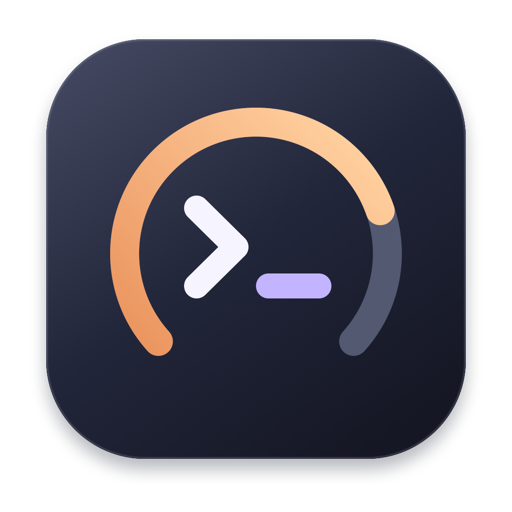
  <h1>CodexUsageBar for macOS</h1>
  <p>A native macOS menu bar app for Codex quota, reset times, and token activity.</p>
  <p><a href="README.md">简体中文</a> · <strong>English</strong></p>
  <p><a href="https://github.com/1078302479/codex-usage-bar/releases/latest">macOS release</a> · <a href="#screenshots">macOS screenshots</a> · <a href="#build-from-source">Build from source</a> · <a href="docs/architecture.md">Architecture</a></p>
</div>

The Windows edition shows quota and reset credits in the Codex sidebar. Its installation guide and screenshot are on the Windows branch. [Windows branch guide](https://github.com/1078302479/codex-usage-bar/blob/windows/README.en.md) · [Windows release](https://github.com/1078302479/codex-usage-bar/releases/tag/windows-v0.1.7)

## v0.1.20 · Tide interface

- Wave and Tide cards show both quota windows, reset countdowns, and a depletion forecast. Reset credits, Token activity, and the heatmap share the same popup.
- New menu bar styles include dual rings, two-color bars, and a status light. Settings opens centered and fits the available space on the current display.
- The app uses the Tide rings icon. Updates refresh the app bundle timestamp and keep rollback copies in a format excluded from Spotlight.

[Release notes](docs/releases/v0.1.20.md)

## v0.1.19 · Quota panel and account management

- Start switching from an alternate account's card, then confirm the client restart.
- See reset times alongside countdowns and spot expiring reset credits next to the section title.
- A more compact light and dark panel, a one-line Token summary, and per-account quota and credit counts in Settings.

[Release notes](docs/releases/v0.1.19.md)

## v0.1.17 · Active account verification recovery

- Fixes a wait for an exited verification process that could block refreshes. Rechecks the active account after startup, wake, or a Codex restart and retries temporary read failures.
- Preserves the signed-in status of saved accounts. If the app cannot identify the active account, it explains why and offers a retry.

[Stable downloads](https://github.com/1078302479/codex-usage-bar/releases/latest) · [Release notes](docs/releases/v0.1.17.md)

## v0.1.16 · Duplicate login prevention

- Adding a backup account now checks its identity. If the account is already signed in, the app clears the duplicate backup login and asks you to choose another account.
- Verifies the current login from the running Codex backend's login directory, even while quota data is loading.

[Stable downloads](https://github.com/1078302479/codex-usage-bar/releases/latest) · [Release notes](docs/releases/v0.1.16.md)

## v0.1.15 · Account detection and menu bar colors

- Rechecks the active account after successful quota verification so that account switching can recover when login confirmation is pending.
- Shares red, amber, and green defaults between the menu bar and account picker. Custom ranges take priority.

[Stable downloads](https://github.com/1078302479/codex-usage-bar/releases/latest) · [Release notes](docs/releases/v0.1.15.md)

## v0.1.14 · Automatic update backup cleanup

After a successful in-app update, CodexUsageBar keeps one rollback copy of the previous version for 72 hours. If the app is closed when the backup expires, it removes the copy the next time it opens.

[Stable downloads](https://github.com/1078302479/codex-usage-bar/releases/latest) · [Release notes](docs/releases/v0.1.14.md)

## v0.1.13: low-quota alerts and account comparison

- Enable low-quota alerts for the signed-in account in Settings → Notifications. The default threshold is 10%.
- Compare remaining quota in the account picker. A shared toggle applies your percentage color rules to the picker and the quota card.

[Stable downloads](https://github.com/1078302479/codex-usage-bar/releases/latest) · [Release notes](docs/releases/v0.1.13.md)

## v0.1.12: redesigned UI and focus on the active account

The native popup and Settings now use consistent modular layouts, full-email account cards, a clearer account dropdown, quota bars, reset-credit timelines and Token activity. Browsing another account does not change the desktop login; only Switch and restart does.

Account browsing lasts for the current popup session. Closing restores the active login, and the menu bar always follows that login. Token activity remains available with more accounts; reset-credit details start collapsed. Free accounts show their applicable quota period.

Check for updates in Settings, review the release, download and verify, then explicitly install and restart. The old bundle is retained as a backup. v0.1.8 and earlier require one manual upgrade to obtain the updater.

[Stable downloads](https://github.com/1078302479/codex-usage-bar/releases/latest) · [Release notes](docs/releases/v0.1.12.md) · [Account switching](docs/account-switch.md)

## v0.1.7: account-switch project visibility fix

Fixes empty project lists after updating ChatGPT and switching accounts. Upgrade, finish running work, switch back to the original account, then switch to the alternate account again. Local project metadata and account caches are synchronized with backups; credentials remain separate. Confirmed on ChatGPT macOS 26.1103.31037. [Release notes](docs/releases/v0.1.7.md).

## Overview

CodexUsageBar is a lightweight macOS menu bar utility built with Swift, AppKit, and SwiftUI. It reads quota and official account token activity through your local Codex App Server. No API key entry, browser backend, or Python service is required by the native app.

This is an independent community project, not an official OpenAI application or an OpenAI-affiliated product.

## Features

- Compare quotas in the account picker and browse each account's quota, reset credits and Token activity. The menu bar follows the signed-in account. Account cards in Settings summarize remaining quota and reset credits.
- Start switching from an alternate account's card and confirm the client restart. Accounts share the local workspace and conversation list.
- Online update checks at startup and at most once every 24 hours, with a new-release entry in the popup and manual checks in settings. Review release notes, download and verify the matching archive, then explicitly install and restart.

- Remaining allowances, reset times in Beijing time, and countdowns for independent quota windows. Actual window durations come from the service.
- The menu bar uses red, amber, and green defaults. The account picker uses the standard text color by default and can follow custom percentage rules.
- Wave and Tide quota cards, a compact account and subscription header, and a depletion forecast based on the last 30 minutes, in both light and dark appearance.
- Configurable menu bar metrics, provider icon, labels, plan name, and separators.
- Stacked mode: weekly allowance above the 5-hour allowance, or a regular single-line layout.
- Compact resets: `HH:mm` for the short window and `MM-dd` for the long window, with independently optional descriptions.
- Official lifetime tokens, peak daily tokens, longest-running turn, and current/longest activity streaks.
- A 26-week heatmap with immediate hover/click details and exact daily token counts.
- Event-following refresh with quota-only fallback checks every 15 seconds while the panel is visible and every 60 seconds in the background. Explicit 1-, 5-, and 15-minute polling remains available.
- Official reset-credit count and per-card expiry dates, with cards that expire within 72 hours highlighted.
- Opt-in local expiry reminders 24 hours ahead, with fresh-validation catch-up, persistent account/card deduplication, and cancellation when usage, expiry, or account changes are detected.
- Automatic recovery from network request failures, timeouts, and child-process disconnections with 5/15/30/60/120/300-second backoff, capped at five minutes. A network-return hint expedites one coalesced query. Authentication, configuration, and compatibility errors require user action instead of repeated automatic retries.
- Explicit validation, stale-data, network-failure, login, and compatibility states, with the last successful validation and next retry time. Unverified cached data is labeled separately.
- Light, dark, and system appearance; an expanding/resizable popover; macOS login-item support.

Background resources: settings windows are released on close, and the quota panel releases its view while hidden. Quota monitoring and validation continue. Reopening restores current data and the panel height for the current run. Unchanged menu artwork is reused. Startup log discovery retains only the newest 24 candidates while still enumerating the directory.

## Screenshots

The v0.1.20 Tide popup in light and dark appearance, using sample data.

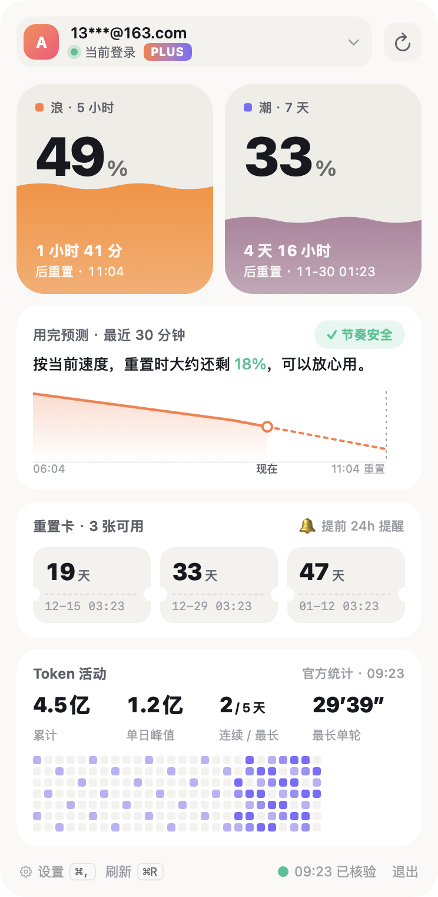 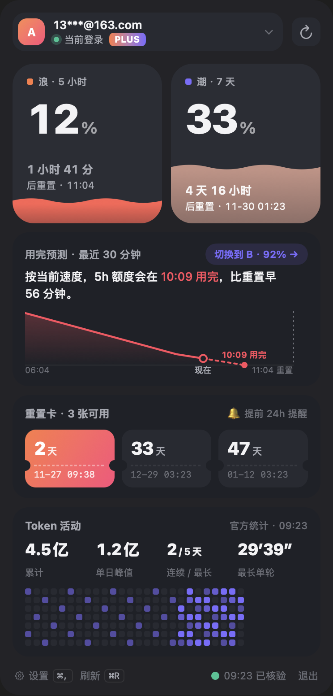

Values reflect the capture time, account emails are masked, and the application UI is Chinese. The full menu bar screenshot was added on **2026-11-11**. The remaining **v0.1.6** screenshots were captured on **2026-10-30**, with some cropped.

### Menu bar and full panel

The two-row menu bar shows weekly and 5-hour remaining quotas with reset times and custom percentage colors. The expanded panel includes both accounts, the alternate-account switching action, reset credits, Token activity and a 26-week usage heatmap.

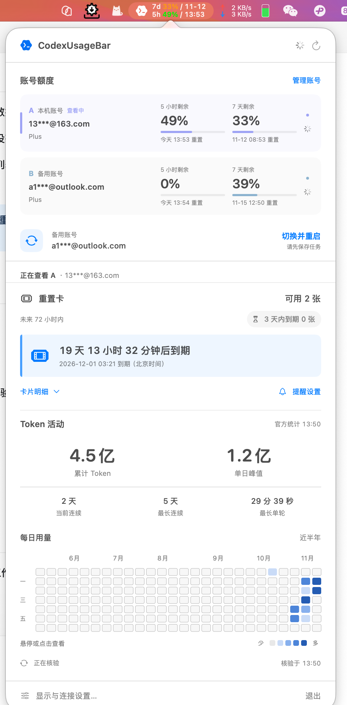

### Single and dual accounts

Single-account gauges and compact dual-account quota/reset rows. Selecting a row updates menu bar quota and details; the execution account is listed first.

<table>
  <tr><th>Single-account panel</th><th>Dual-account overview</th></tr>
  <tr>
    <td valign="top">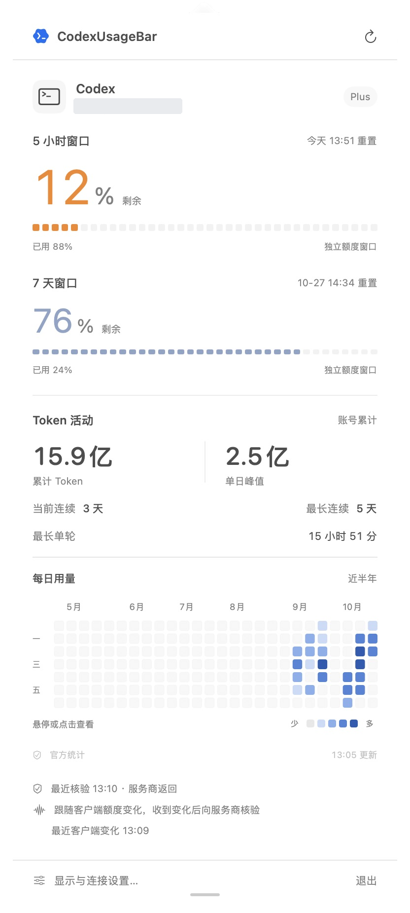</td>
    <td valign="top">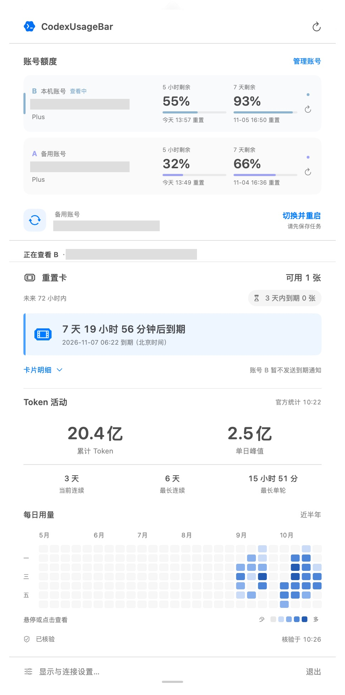</td>
  </tr>
</table>

### One-click execution account switching

Switch to the alternate account with a client restart while retaining the workspace and conversation list. Finish tasks and save work first. Viewing quotas does not switch execution identity.


### Token activity and reset credits

Official totals, peak daily usage, streaks, longest turn and a 26-week activity heatmap. Hover or click a date for details. The dual-account screenshot also shows reset-credit availability and expiry.

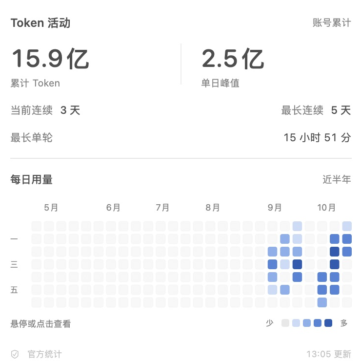

### Menu bar customization and online updates

Customize stacked rows, quotas, reset times, labels, separators and percentage colors. Check stable GitHub updates automatically at most once every 24 hours or manually.

<table>
  <tr><th>Menu bar settings</th><th>Updates and quota validation</th></tr>
  <tr>
    <td valign="top">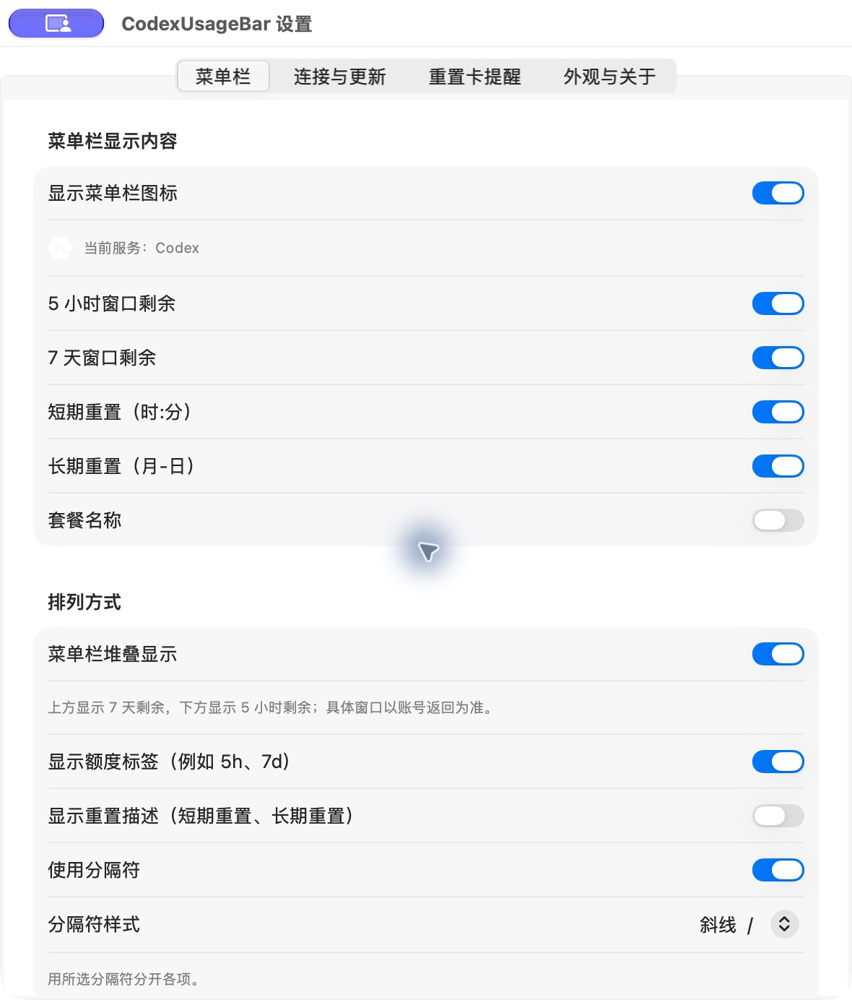</td>
    <td valign="top">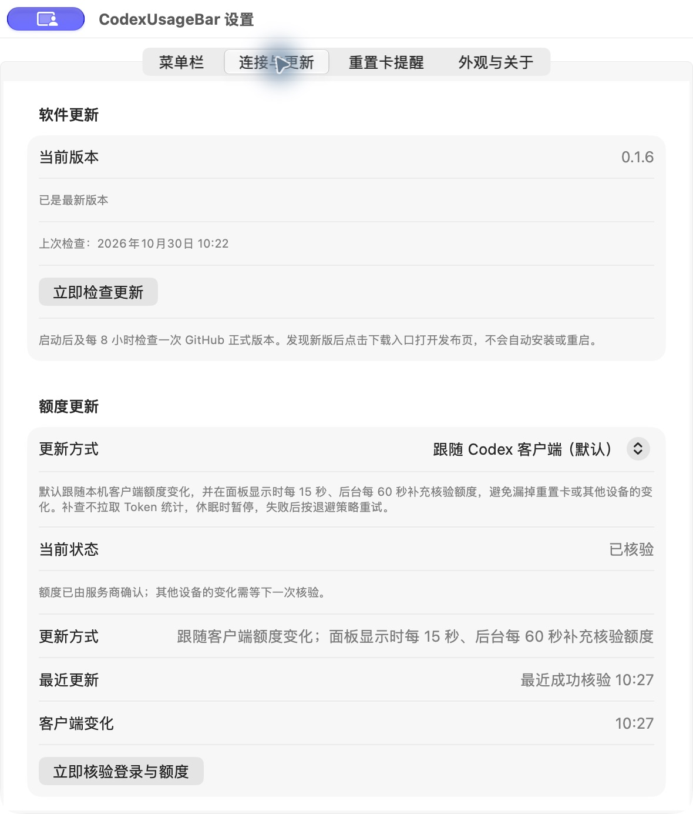</td>
  </tr>
</table>

### Account management and appearance

Authorize a second account through the official login page; stopping monitoring retains its login. Light, dark and system appearance are supported. The appearance screenshot is a cropped settings view.

<table>
  <tr><th>Connection and accounts</th><th>Appearance and version</th></tr>
  <tr>
    <td valign="top">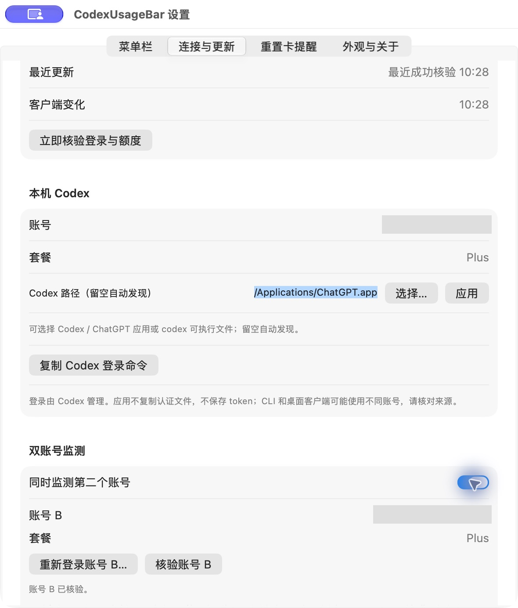</td>
    <td valign="top">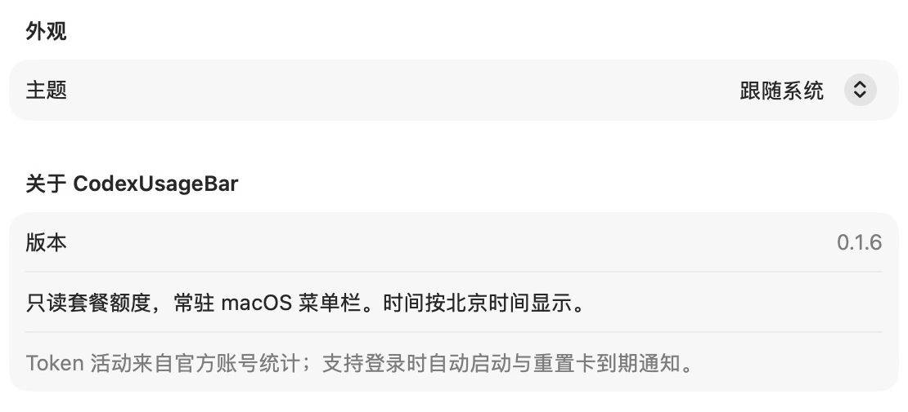</td>
  </tr>
</table>

## Requirements

| Item | Requirement |
| --- | --- |
| OS | macOS 14 or later |
| First release binary | Apple Silicon / arm64 |
| Codex | Installed and signed in with a ChatGPT account; required App Server methods must be supported |
| Network | Access to official Codex services |

No Intel binary is provided and Intel hardware has not been validated. API-key-only authentication does not provide the ChatGPT quota/account activity used by this app.

## Install

1. Download `CodexUsageBar-0.1.7-mac-arm64.dmg` from [Releases](https://github.com/1078302479/codex-usage-bar/releases/latest).
2. Open the DMG and drag **CodexUsageBar** into **Applications**.
3. Eject the installation disk and launch the app from Applications.
4. Optionally enable **Settings → Appearance & About → Launch at login**. The current UI is in Chinese.

Quit older copies before updating, launch CodexUsageBar after installation. The bundle identity is retained to preserve existing preferences.

**Signing:** the first release is ad-hoc signed and is not Apple Developer ID signed or notarized. macOS may show a security prompt. Check the release source and SHA256 checksums; build from source if you prefer not to run an unnotarized binary. Login items can require approval in System Settings and should be registered after moving the app to a stable location.

## Getting started

The app discovers Codex automatically. If discovery fails, select the executable in the connection settings. Sign in through Codex itself and check the masked account shown in the panel: the CLI and desktop client may use different accounts.

The app does not directly read authentication files, persist tokens, or start model inference. Codex owns authentication and network requests. Display preferences and a masked quota cache are stored locally; cached quota is revalidated after every launch. Account token activity is kept in memory only.

## Data and refresh behavior

### Online software updates

Open **Settings → Connection & Refresh → Software Update** to see the installed version and last check, or check manually. The app triggers checks at startup and hourly, skipping automatic checks within 24 hours of the last success. Manual checks bypass this delay. Stable releases are the default; preview releases are opt-in. GitHub API failures fall back to the stable release page for manual downloads.

When a newer version is available, open its in-app release notes. Choose Download and verify; after checksum, bundle identity, version, signature and architecture checks pass, choose Install and restart. Stable releases are the default; preview releases are opt-in. Failed checks/downloads can be retried. The previous app is retained as a backup. No GitHub token or Codex account information is sent.

Online update checking is included in the refreshed v0.1.6 installer (build 11). If you downloaded v0.1.6 earlier, download it again and replace the installed app.

### Two-account monitoring (v0.1.6)

Enable **Settings → Connection & Refresh → Two-account monitoring**, choose **Sign in to a second account**, and select another ChatGPT account on the official login page. Account A follows the local Codex login; account B has an independent session. Both are checked concurrently, with compact quota/reset comparison rows. Select either card to view its reset credits, Token activity, and connection status below. A single menu bar item follows the account selected in the panel; selecting A or B switches both details and menu bar quota. The panel's top refresh button validates both accounts.

B uses `~/Library/Application Support/CodexUsageBar/accounts/secondary` as its isolated `CODEX_HOME`, with credentials managed by Codex in a user-private directory. The app never reads or copies A's authentication files. Disabling B stops monitoring but retains its login for later use. Reset-credit notifications follow the active primary account; the backup account does not send reminders. Signing into the same account twice does not combine or increase allowance.

Included in v0.1.6. Known desktop backend launch patterns identify the active account; unknown or conflicting instances disable switching. Switching gracefully quits and reopens ChatGPT: finish tasks and save work first. The original desktop workspace remains in use, with shared session/task state. No tokens are copied and no model proxy is used. Internal desktop overrides may change with client updates; verify the native Codex identity after restarting.

### Refresh rules

- Remaining allowance is `100 − usedPercent`, with independent windows.
- The default mode observes local quota events and validates changes against the service. Startup, opening the panel, waking, and reset boundaries also trigger checks.
- **Instant synchronization with the Codex client or other devices is not guaranteed.** Remote changes may appear at the next validation.
- Stale values have `*`; unknown, unverified, and reset-pending values show `--`. A timer never fabricates a refill to 100%.
- Activity comes from official `account/usage/read` and may lag. Missing data is not zero; local logs are not used to invent account-wide totals.
- Longest-running turn means the service's turn duration, not total conversation wall-clock time.
- Times use **Asia/Shanghai**. Heatmap dates preserve the service's date buckets.

See [architecture notes](docs/architecture.md) and the [official App Server documentation](https://learn.chatgpt.com/docs/app-server).

## Build from source

Use macOS with a Swift 6-capable Xcode/Command Line Tools installation. Python 3 is used for tests and packaging, not by the native runtime.

```sh
git clone https://github.com/1078302479/codex-usage-bar.git
cd codex-usage-bar
bash scripts/build-native.sh
```

Output: `build/CodexUsageBar.app`.

Checks:

```sh
bash scripts/test-native.sh
python3 -m unittest discover -s tests -v
node --check prototype/app.js
```

The native suite includes 39 core checks, 9 heatmap hit-region checks, and recent-file selection across 1,000 logs. Optional window lifecycle, real filesystem, and account probes:

```sh
bash scripts/test-native.sh --ui
bash scripts/test-native.sh --transport
bash scripts/test-native.sh --watch
.build/QuotaProbe
.build/QuotaProbe --activity
```

`--ui` exercises 30 settings-window cycles and 100 panel cycles with isolated preferences and no account requests, checking resource release, reopening, height retention, and menu artwork reuse. These checks do not validate extended uptime or real sleep/wake memory behavior.

The default suite also checks retry coordination, backoff, explicit retries, user-action errors, network-return hints, sleep cancellation, and stale-result isolation. `--transport` uses a temporary CLI fixture to test real stdio, child replacement, timeout recovery, and simulated in-flight sleep/wake. It does not change the real network or put the computer to sleep.

Live probes print masked account/usage metadata; review and redact their output before sharing. Restricted environments may block App Server, FSEvents, or disk-image operations; use a normal macOS terminal.

## Package a DMG

```sh
python3 -m pip install --target .build/dmg-python ds-store==1.3.1 mac-alias==2.2.2
bash scripts/build-dmg.sh
```

The script creates a read-only drag-to-install DMG and verifies its checksum. It does not install the app automatically. Build products and caches are excluded from Git.

## Repository layout

```text
native/Sources/     Native UI, quota client, local event monitoring and activity
native/Resources/   Approved application artwork and resource notes
native/Tests/       Quota, formatting, preference migration and heatmap checks
native/Tools/       Icon generation, installer artwork and diagnostic probes
scripts/           Build, test, package and early protocol experiments
prototype/         Early browser prototype; some interactions use demo data
tests/             Python adapter tests
docs/              Architecture, release notes and maintenance documentation
```

## Limits and feedback

Only reset-credit expiry notifications are included; low-quota notifications, per-session details, and additional providers are not included. Expiry reminders are off by default. Opted-in users gain 15-minute card checks and a check before known reminder times. Card usage on another device is detected at the next validation. Normal quit preserves scheduled local notifications; shutdown, sleep, or Focus may delay delivery. Real system-banner delivery and reboot behavior still need validation after notification consent.

Expired authentication, real account switching, extended uptime, different Codex versions, and actual login-after-reboot behavior need broader validation. Real local account reads, reset-credit details, and the main native UI flows have been verified.

Report issues through [GitHub Issues](https://github.com/1078302479/codex-usage-bar/issues). Include macOS, architecture, Codex, and app versions. Remove account identifiers, email addresses, tokens, and personal usage information. See [CONTRIBUTING.md](CONTRIBUTING.md).

## License and marks

This project is fully open source under the **[Apache License 2.0](LICENSE)**, permitting free use, modification, redistribution, and commercial use. Redistribution must comply with the license, including providing a copy of the license, retaining applicable copyright and attribution notices, and prominently marking modified files. See [NOTICE](NOTICE) for attribution. The software is provided "AS IS", without warranties.

This grant also covers the project's original code and its builds published as v0.1.1 in this repository. Codex, OpenAI, and other third-party names and marks remain the property of their owners. This license grants no additional rights to third-party trademarks or assets; the project name describes the supported service.
