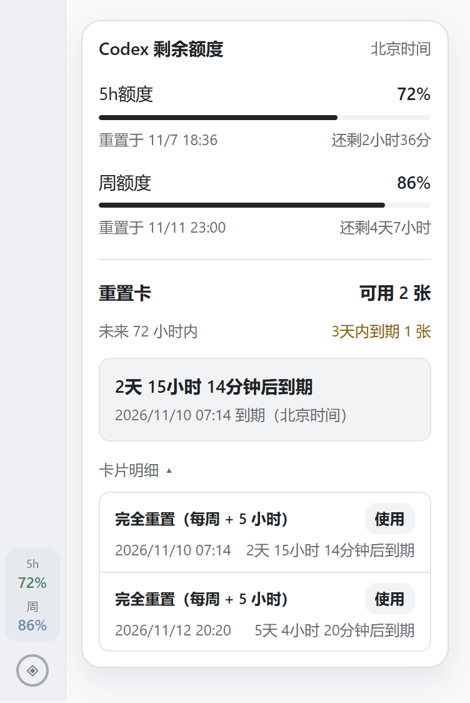

# Codex UsageBar for Windows

[简体中文](README.md) · [Windows release](https://github.com/1078302479/codex-usage-bar/releases/tag/windows-v0.1.3) · [macOS edition](https://github.com/1078302479/codex-usage-bar/tree/main)

See remaining short-window and weekly quota in the Codex sidebar. Hover for reset times in Beijing time, countdowns, and reset-credit details. Card details open expanded. **Use** takes you to the **Usage limit resets** section of Codex settings.

## Download and install

1. Install the official Codex app from the Microsoft Store on **Windows 11 x64**.
2. Download and run **CodexUsageBar-Windows-x64-Setup.exe**, then follow the wizard. The installer includes the runtime. [Download the EXE](https://github.com/1078302479/codex-usage-bar/releases/download/windows-v0.1.3/CodexUsageBar-Windows-x64-Setup.exe)
3. Save your work and exit Codex, then open **Codex UsageBar** from the desktop or Start menu.

This community preview generates a separate client copy from the installed Store app. The installer is unsigned, so Windows may display an unknown-publisher prompt. [Compatibility, upgrade and uninstall instructions](windows/README.en.md)

Starting with v0.1.1, each launch from a **Codex UsageBar** shortcut checks for Windows updates in the background. When an update is available, confirm to download it and open the setup wizard. Run the new installer once to upgrade from v0.1.0.

Starting with v0.1.3, open **Codex UsageBar Settings** from Start to check for updates, toggle startup checks, or choose which quota and reset-credit information to display. Save your display settings, then fully quit and reopen Codex UsageBar to apply them.

## Windows screenshot

The screenshot uses the released sidebar and reset-credit components with sample data.

## Development

[Install from source and build the EXE](windows/README.en.md#install-from-source) · [Sidebar patch notes](windows/patch/README.md) · [Apache 2.0 license](LICENSE)
