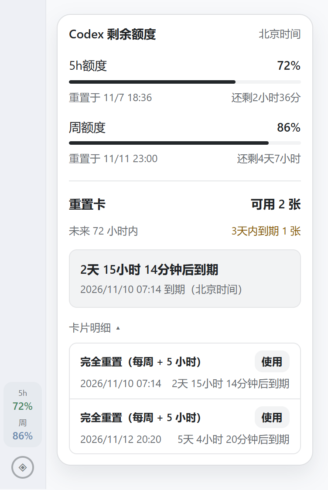

# Codex UsageBar for Windows

[English](README.en.md) · [Windows 发布页](https://github.com/1078302479/codex-usage-bar/releases/tag/windows-v0.1.5) · [macOS 版](https://github.com/1078302479/codex-usage-bar/tree/main)

在 Windows 版 Codex 的左侧导航栏查看短周期和每周剩余额度。悬停可查看北京时间的重置时间、倒计时和重置卡明细。卡片明细默认展开，点击「使用」可定位到 Codex 设置里的「使用限额重置」。

点击弹框右上角的图钉，可把额度弹框变成跨应用置顶小窗。再点一次图钉即可关闭。

## 下载与安装

1. 在 **Windows 11 x64** 上通过 Microsoft Store 安装官方 Codex。
2. 下载并双击 **CodexUsageBar-Windows-x64-Setup.exe**，按向导完成安装。运行环境已包含在安装包里。[直接下载 EXE](https://github.com/1078302479/codex-usage-bar/releases/download/windows-v0.1.5/CodexUsageBar-Windows-x64-Setup.exe)
3. 保存工作并退出当前 Codex，再从桌面或开始菜单打开 **Codex UsageBar**。

这是社区预览版。安装程序从本机的 Store 版 Codex 生成独立副本。安装包尚未签名，Windows 可能提示发布者未知。[兼容性、升级和卸载说明](windows/README.md)

从 v0.1.1 起，每次通过 **Codex UsageBar** 快捷方式打开时都会在后台检查 Windows 更新。发现新版后，可确认下载并打开安装向导。v0.1.0 用户需要先手动运行一次新版安装包。

从 v0.1.4 起，打开 Codex UsageBar 后可从任务栏右下角的托盘图标进入偏好设置，也可在开始菜单打开 **Codex UsageBar Settings**。在偏好设置中可以检查更新、选择侧栏显示内容。保存显示选项后，确认重启即可应用。

## Windows 界面截图

截图使用发布版侧栏和重置卡组件，以示例数据渲染。

## 开发

[从源码安装及构建 EXE](windows/README.md#从源码安装) · [侧栏补丁原理](windows/patch/README.md) · [Apache 2.0 许可证](LICENSE)
